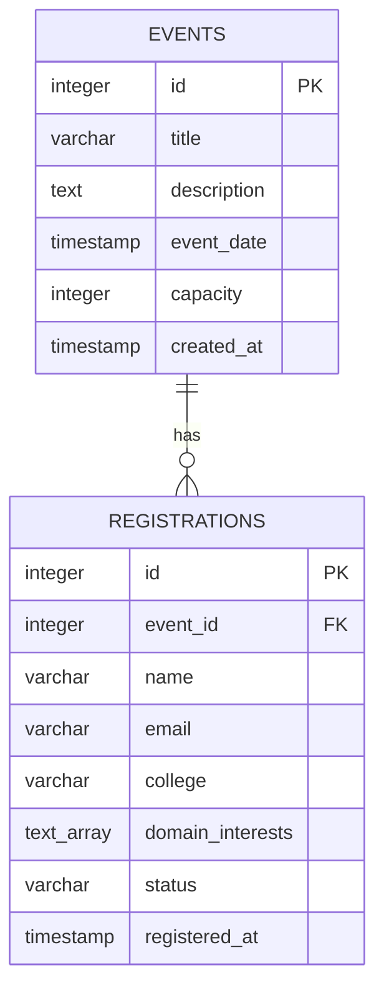

# Event Management System

A full-stack Event Management System built with the PERN stack (PostgreSQL, Express.js, React, and Node.js). 
The application allows users to discover events, register as participants, and track event capacity, 
while administrators can securely access registration information through an admin dashboard.

## Features

- **Public event showcase:** View event titles, descriptions, schedules, capacity, and registration counts.
- **Event registration:** Register using your name, email, college or organization, and domain interests.
- **Duplicate prevention:** Prevents the same email address from registering multiple times for the same event.
- **Capacity management:** Checks event capacity before confirming registrations.
- **Admin authentication:** Secure administrator login using password hashing and JWT-based authentication.
- **Admin dashboard:** View and search participant registrations, event information, and registration statuses.
- **PostgreSQL database:** Store event and registration records with relational constraints.
- **Cloud deployment:** Frontend and backend hosted separately on Vercel, with Neon PostgreSQL as the hosted database.

## Technology Stack

| Layer | Technologies |
|---|---|
| Frontend | React, Vite, CSS |
| Backend | Node.js, Express.js |
| Database | PostgreSQL, Neon |
| Authentication | bcryptjs, JSON Web Tokens (JWT) |
| Deployment | Vercel |
| API testing | Thunder Client |

## Database Schema Diagram

The database consists of two main tables: `events` and `registrations`.



### Table Relationships

- **Events:** Stores event details, including the title, description, date, and participant capacity.
- **Registrations:** Stores participant details and references an event through `event_id`.
- **One-to-many relationship:** An event can have multiple registrations, while each registration belongs to one event.
- **Foreign key:** `registrations.event_id` references `events.id`. Deleting an event also deletes its associated registrations.
- **Unique constraint:** The combination of `event_id` and `email` must be unique, preventing duplicate registrations for the same event.
- **Status constraint:** Registration status can only be `Confirmed` or `Cancelled`.

## Database Schema

The following SQL creates the database tables. Run it against your PostgreSQL database if the tables have not already been created.

```sql
CREATE TABLE events (
    id INTEGER GENERATED ALWAYS AS IDENTITY PRIMARY KEY,
    title VARCHAR(150) NOT NULL,
    description TEXT NOT NULL,
    event_date TIMESTAMP NOT NULL,
    capacity INTEGER NOT NULL CHECK (capacity > 0),
    created_at TIMESTAMP DEFAULT CURRENT_TIMESTAMP
);

CREATE TABLE registrations (
    id INTEGER GENERATED ALWAYS AS IDENTITY PRIMARY KEY,
    event_id INTEGER NOT NULL
        REFERENCES events(id) ON DELETE CASCADE,
    name VARCHAR(100) NOT NULL,
    email VARCHAR(255) NOT NULL,
    college VARCHAR(150) NOT NULL,
    domain_interests TEXT[] NOT NULL,
    status VARCHAR(20) NOT NULL DEFAULT 'Confirmed'
        CHECK (status IN ('Confirmed', 'Cancelled')),
    registered_at TIMESTAMP DEFAULT CURRENT_TIMESTAMP,
    CONSTRAINT unique_event_email UNIQUE (event_id, email)
);
```

## Database Seed Data

Seed data provides sample events and participant registrations for testing the application and demonstrating its features.

Run the following SQL in your local PostgreSQL database or the Neon SQL Editor. 
**Run the event inserts before the registration inserts.** 
The statements use `ON CONFLICT DO NOTHING` where appropriate, making repeated execution safer.

### 1. Insert sample events

```sql
INSERT INTO events (
    title,
    description,
    event_date,
    capacity
)
VALUES
(
    'AI and Machine Learning Workshop',
    'An introductory workshop covering machine learning concepts, practical demonstrations, and real-world applications.',
    '2027-01-15 10:00:00',
    100
),
(
    'Full Stack Web Development Bootcamp',
    'A hands-on session exploring frontend development, backend APIs, and relational database integration.',
    '2027-02-10 09:30:00',
    80
),
(
    'Cybersecurity Awareness Seminar',
    'A seminar covering secure coding practices, common cyber threats, and strategies for protecting digital systems.',
    '2027-03-05 11:00:00',
    120
)
ON CONFLICT DO NOTHING;
```

### 2. Insert sample registrations

The following statements associate each participant with an event by its title, so they do not depend on manually assigned event IDs.

```sql
INSERT INTO registrations (
    event_id,
    name,
    email,
    college,
    domain_interests
)
SELECT
    e.id,
    sample.name,
    sample.email,
    sample.college,
    sample.domain_interests
FROM (
    VALUES
    (
        'AI and Machine Learning Workshop',
        'Aarav Sharma',
        'aarav@example.com',
        'ABC Engineering College',
        ARRAY['AI/ML', 'Data Science']::TEXT[]
    ),
    (
        'AI and Machine Learning Workshop',
        'Priya Nair',
        'priya@example.com',
        'XYZ Institute of Technology',
        ARRAY['AI/ML', 'Research']::TEXT[]
    ),
    (
        'Full Stack Web Development Bootcamp',
        'Rahul Verma',
        'rahul@example.com',
        'ABC Engineering College',
        ARRAY['Web Development', 'Backend']::TEXT[]
    ),
    (
        'Full Stack Web Development Bootcamp',
        'Sneha Rao',
        'sneha@example.com',
        'XYZ Institute of Technology',
        ARRAY['Frontend', 'UI/UX']::TEXT[]
    ),
    (
        'Cybersecurity Awareness Seminar',
        'Arjun Kumar',
        'arjun@example.com',
        'National College',
        ARRAY['Cybersecurity', 'Networking']::TEXT[]
    )
) AS sample(
    event_title,
    name,
    email,
    college,
    domain_interests
)
JOIN events e ON e.title = sample.event_title
ON CONFLICT (event_id, email) DO NOTHING;
```

### 3. Verify the seed data

Check the event records and their confirmed registration counts:

```sql
SELECT
    e.id,
    e.title,
    e.event_date,
    e.capacity,
    COUNT(r.id) FILTER (
        WHERE r.status = 'Confirmed'
    )::INTEGER AS registration_count
FROM events e
LEFT JOIN registrations r
    ON r.event_id = e.id
GROUP BY e.id
ORDER BY e.event_date;
```

View all participant registrations:

```sql
SELECT
    r.id,
    e.title AS event_title,
    r.name,
    r.email,
    r.college,
    r.domain_interests,
    r.status,
    r.registered_at
FROM registrations r
JOIN events e ON e.id = r.event_id
ORDER BY r.registered_at DESC;
```

> **Note:** The sample events use future dates. Seed data is for demonstration and testing;
> it should not be treated as real participant information.

## API Routes

The backend exposes the following REST API endpoints.

| Method | Endpoint | Description | Authentication |
|---|---|---|---|
| GET | `/api/events` | Retrieve events and confirmed registration counts | Public |
| POST | `/api/registrations` | Register a participant for an event | Public |
| POST | `/api/admin/login` | Authenticate an administrator | Public |
| GET | `/api/admin/registrations` | Retrieve and search registrations | Admin JWT required |

### Registration behavior

- Successful registration returns HTTP `201 Created`.
- Missing or invalid registration data returns a client error.
- Registering the same email for the same event returns HTTP `409 Conflict`.
- Registration is rejected when the event has reached capacity.
- Access to the administrator registration endpoint requires a valid bearer token.

## Project Structure

```text
event-management-system/
├── frontend/
│   ├── src/
│   │   ├── App.jsx
│   │   ├── App.css
│   │   ├── AdminDashboard.jsx
│   │   └── AdminDashboard.css
│   ├── index.html
│   ├── package.json
│   └── vercel.json
│
├── backend/
│   ├── config/
│   │   └── db.js
│   ├── api/
│   │   └── index.js
│   ├── server.js
│   ├── package.json
│   └── vercel.json
│
└── README.md
```

## Setup Instructions

### Prerequisites

Install Node.js and PostgreSQL, or configure a hosted PostgreSQL database such as Neon. 
Git is recommended for version control.

### 1. Clone the repository

```bash
git clone https://github.com/Grace422/CodeNova-Internship-Event-Registration-Platform
cd Event-Registration-Platform
```

### 2. Configure the backend

```bash
cd backend
npm install
```

Create a `.env` file inside `backend/` with your local database settings:

```env
PORT=5000
DB_HOST=localhost
DB_PORT=5433
DB_NAME=event_management
DB_USER=YOUR_LOCAL_DB_USERNAME
DB_PASSWORD=YOUR_LOCAL_DB_PASSWORD

ADMIN_USERNAME=YOUR_ADMIN_USERNAME
ADMIN_PASSWORD_HASH=YOUR_BCRYPT_PASSWORD_HASH
JWT_SECRET=YOUR_RANDOM_JWT_SECRET
```

Keep the local database credentials appropriate for your PostgreSQL installation. 
The backend also supports `DATABASE_URL` for a hosted PostgreSQL connection.

Start the backend:

```bash
npm run dev
```

The local API should be available at `http://localhost:5000`.

### 3. Configure the frontend

Open another terminal:

```bash
cd frontend
npm install
```

Create a `.env` file in the frontend root:

```env
VITE_API_URL=http://localhost:5000
```

Start the frontend:

```bash
npm run dev
```

Open the local URL printed by Vite in the terminal.

### 4. Access the administrator dashboard

- Public event page: open the frontend root URL.
- Admin dashboard: open the frontend URL followed by `/admin`.

For local development, this is typically `http://localhost:5173/admin`, unless Vite chooses a different port.

## Environment Variables for Deployment

Configure environment variables in the relevant Vercel project settings rather than committing secrets to GitHub.

**Backend project**
- `DATABASE_URL` — Neon PostgreSQL connection string.
- `ADMIN_USERNAME` — configured administrator username.
- `ADMIN_PASSWORD_HASH` — bcrypt hash of the administrator password.
- `JWT_SECRET` — secret used to sign JWT tokens.
- `NODE_ENV` — set to `production`.

**Frontend project**
- `VITE_API_URL` — base URL of the deployed backend, without the `/api/events` suffix.

After changing deployment environment variables, redeploy the relevant Vercel project so the changes take effect.

## Deployment

The application is deployed as separate services:

- **Frontend:** Vercel, serving the React application.
- **Backend:** Vercel, serving the Express API.
- **Database:** Neon PostgreSQL.

The frontend uses `VITE_API_URL` to communicate with the deployed backend. Ensure that the backend's CORS configuration allows requests from your frontend domain.

## Security Considerations

- Passwords are verified using bcrypt hashes rather than stored as plaintext.
- Administrator endpoints use JWT-based authentication.
- Database access credentials and signing secrets must remain private.
- Registration emails are unique per event.
- Input validation and capacity checks help prevent invalid registrations.
- Production deployments should use HTTPS and restrict CORS to trusted frontend origins.

## Live Deployment

The Event Management System is deployed using the following services:

- **Frontend (Vercel):** [Open the application](https://code-nova-internship-event-registra.vercel.app/)
- **Backend API (Vercel):** [View the API](https://code-nova-internship-event-registra-orcin.vercel.app/)
- **Database (Neon):** Hosted PostgreSQL database used to store event and registration data.

**Admin Dashboard:** Access the administrator interface by appending `/admin` to the frontend URL.
